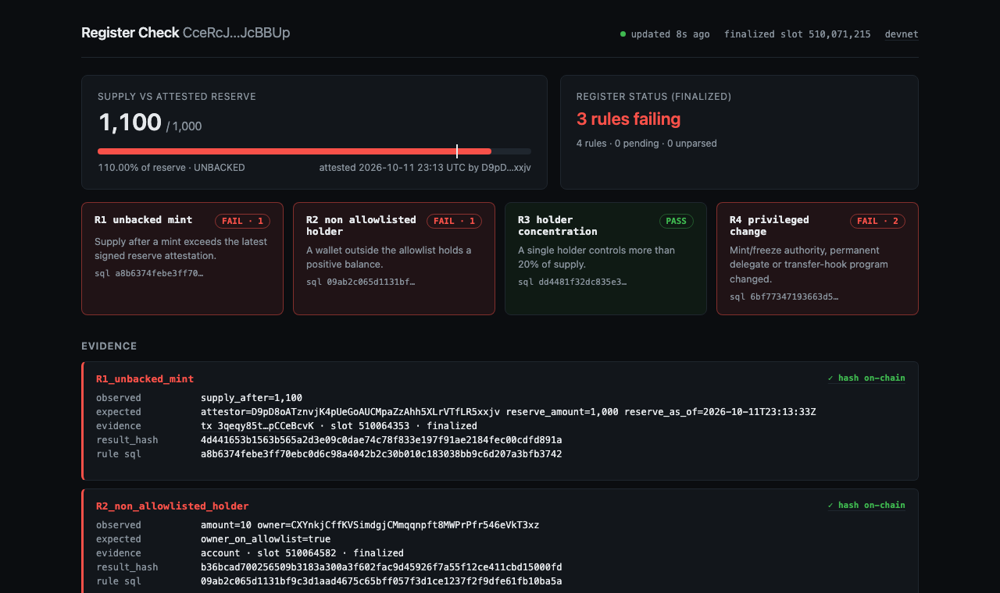
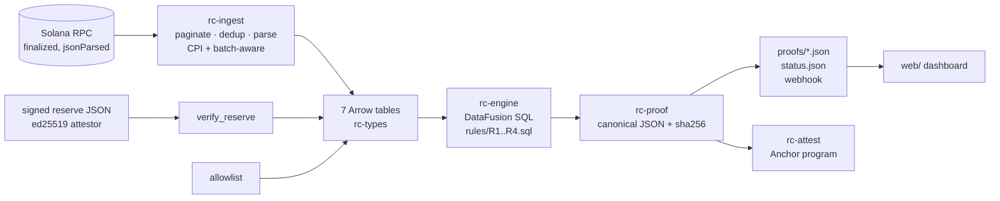

# Register Check

**Continuous, reproducible register checks for Solana Token-2022 mints.**
Register Check watches a token's finalized history, runs four SQL rules over it with DataFusion, and turns every violation into a proof bundle sealed with a deterministic hash. Anyone can re-fetch the cited transaction and re-run the SQL to get the same violating row, and anyone can recompute the seal. The seal is also recorded on-chain.

> Reserve evidence for tokenized dollars is a monthly PDF. Supply changes every slot.
> Register Check closes the gap between reports: a mint that exceeds the signed reserve is flagged **seconds** after it finalizes, and the evidence comes attached.



## Live on devnet

Everything below was produced by this repo on devnet on 2026-10-12.

| What | Link |
|---|---|
| Demo Token-2022 mint (permanent delegate + transfer hook) | [`CceRcJNK…JcBBUp`](https://explorer.solana.com/address/CceRcJNKkxWuSZxJWeWKunSkHH3i8njpHa7dYoJcBBUp?cluster=devnet) |
| Mint that pushed supply to 1,100 over a 1,000 reserve | [`3qeqy85t…CeBcvK`](https://explorer.solana.com/tx/3qeqy85tzVHYvXgkY9i4roHn2BzkKfGabSH4wpdcyiuMWpkrW1p5QtP44baPJeQiqp8BCcYsu4iCAcNepCCeBcvK?cluster=devnet) |
| R1 alert latency | **4 s** from sending the mint to the proof file (devnet finality trails confirmation by about 4 slots) |
| `rc-attest` program | [`BNADNdmc…LthV3`](https://explorer.solana.com/address/BNADNdmc5zJF54Tj6o1ctr3PmhjjDFPByPGGU3oLthV3?cluster=devnet) |
| R1 result hash recorded on-chain | [`2jShsi1M…hLjktN`](https://explorer.solana.com/tx/2jShsi1MxT7LRdv8L7poJU64SHu8LDrYYzX4zXFujY4L7QR3s2d7v1sVg98pSTJ7H2WGHQ4q4wqGzKuAShNLjktN?cluster=devnet) |

The on-chain `CheckResult` account stores `4d441653…cdfd891a` at slot 510064353, the same hash and slot as the proof file. R2 (a stranger wallet received tokens) and R4 (transfer hook swapped, then swapped back) also fired live and were attested.

## The four rules

Each rule is a static SQL file in [`rules/`](rules). There are no parameters and no string interpolation, so config can't inject SQL. Its sha256 is registered on-chain, so every result points at the exact SQL that produced it.

| Rule | Fires when |
|---|---|
| **R1 unbacked_mint** | `supply_after` of any mint > the latest signed reserve attestation |
| **R2 non_allowlisted_holder** | a wallet outside the allowlist holds a positive balance **or received tokens in any transfer** (catches pass-through) |
| **R3 holder_concentration** | one holder has > 20% of supply (math in `DECIMAL(38,0)`: no u64 overflow) |
| **R4 privileged_change** | mint/freeze authority, permanent delegate, transfer-hook program, or transfer-hook authority changed |

```sql
-- R1 unbacked_mint
SELECT m.mint, m.signature, m.slot, m.supply_after, r.reserve_amount, r.as_of_ts, r.attestor
FROM mints m
JOIN latest_reserve r ON m.mint = r.mint
WHERE m.supply_after > r.reserve_amount
ORDER BY m.mint, m.slot, m.tx_index, m.ix_index
```

Three **R0 integrity checks** run on every poll. If one fails, the dashboard is red, never vacuously green:

- **R0_supply_drift**: supply computed from parsed events ≠ `getTokenSupply`. This catches a mint variant we failed to parse.
- **R0_balance_drift**: a known token account's on-chain balance ≠ the ingested history, across two consecutive polls. This catches token movements whose transaction never references the mint. An example is an unchecked `transfer` on a plain Token-2022 mint; Token-2022 rejects those when the hook, fee or pause extensions are present.
- **R0_reserve_evidence**: no valid signed reserve, a reserve older than 7 days, or a rejected attestation. Without it R1 would pass for lack of evidence.

## Architecture



| Crate | Role |
|---|---|
| `crates/rc-types` | The 7 register tables (`mints`, `burns`, `transfers`, `balances`, `authority_changes`, `reserves`, `allowlist`) as Rust structs + Arrow schemas |
| `crates/rc-ingest` | Raw JSON-RPC ingester: `getSignaturesForAddress` → `getTransaction` (finalized). Parses Token-2022 by **program id**, walks CPI inner instructions and `batch`-wrapped instructions, flags permanent-delegate burns, derives balances from `postTokenBalances`, reconciles supply and every token account's balance. A failed fetch never loses signatures; a malformed tx is reported, never fatal. Verifies reserve signatures |
| `crates/rc-engine` | DataFusion `SessionContext` with MemTables plus `latest_reserve` / `supply` views; runs the rule files |
| `crates/rc-proof` | Proof bundles with its own canonical JSON writer (sorted keys at every level, integers as strings) and `result_hash` |
| `crates/rc-cli` | `rc check`, `rc sign-reserve`, `rc watch [--attest]`, `rc attest` |
| `programs/rc-attest` | Anchor 1.2.1: `Config` (only the program's upgrade authority can initialize it), `Rule` (seeded by rule id + SQL hash), `CheckResult` (seeded by result hash: no duplicates). No token logic |
| `web/` | Static dashboard (no build step) |

## Verify a proof yourself

```bash
python3 -I scripts/verify_proof.py docs/evidence/R1_live_devnet.json  # a real devnet proof, attested on-chain
python3 -I scripts/verify_proof.py fixtures/proof/r1_demo.golden.json   # golden test fixture
python3 -I scripts/verify_proof.py proofs/*.json                       # proofs from your own watcher
```

- **The seal:** `result_hash = sha256(compact JSON, keys sorted, without result_hash and attested_tx)`. The verifier is about 20 lines of Python stdlib and shares no code with the Rust implementation.
- **What it covers:** the evidence row, the rule's SQL hash, the cited signature and slot, the reserve attestation used, and the RPC label (the query string is stripped, so API keys never leak). It is an integrity seal over the bundle.
- **Re-deriving the facts:** open the bundle's `explorer` link, check the transaction, and re-run the rule SQL from `rules/` (its sha256 is in the bundle as `rule_sql_sha256`).

## Run it

Requirements: Rust (pinned by `rust-toolchain.toml` to 1.97.1), Solana/Agave CLI ≥ 4.3, `spl-token` CLI, Anchor 1.2.1 (only to rebuild the program), Python 3.

```bash
cargo test --workspace                      # 61 offline tests (RecordBatch + saved devnet fixtures)

scripts/devnet_setup.sh                     # create a demo Token-2022 mint (keys in .secrets/, gitignored)
scripts/demo.sh init                        # allowlist, attestor key, signed 1,000 reserve
scripts/demo.sh watch --attest              # follow the mint; proofs/ + status.json; hashes on-chain
scripts/demo.sh dashboard                   # http://127.0.0.1:8080/web/

scripts/demo.sh mint 100                    # supply 1,100 > reserve 1,000  -> R1
scripts/demo.sh stranger 10                 # tokens to a non-allowlisted wallet -> R2
scripts/demo.sh swap-hook                   # transfer-hook program changed -> R4
scripts/demo.sh unhook                      # hook back to none -> second R4 row
scripts/demo.sh reserve 1100                # issuer signs a new reserve; R1 clears
scripts/demo.sh reset                       # fresh all-green mint for another take (old evidence archived)
```

`rc check --register fixtures/demo/register.json` runs the rules offline over a JSON register.

## Testing

- **Every rule** has a `pass` fixture (0 rows) and a `fail` fixture with exact expected rows. The fail fixtures cover edge cases: reserve timestamp ties pick the lower reserve, exactly 20% is not a violation, burns reduce supply, u64::MAX amounts, a hook swapped and swapped back.
- **rc-ingest** is tested on **real finalized devnet responses** (`fixtures/rpc/`, captured by `scripts/capture_fixtures.py`). Cases covered:
  - CPI inner mints and batch-wrapped mints
  - legacy SPL Token look-alikes ignored; unknown instructions reported
  - failed txs; more than 1,000 signatures with a page overlap; scrambled arrival order
  - an RPC error mid-poll (nothing lost) and an unserved tx (kept pending, no false drift)
  - a malformed tx (reported, not fatal); a hook-authority vs hook-program mix-up
  - supply drift, and a hidden balance change (balance drift)
- **rc-proof** has a golden file, a key-order independence test, and tamper detection.
- **rc-attest** uses LiteSVM: init only by the upgrade authority, authority checks, duplicate rule versions and results, unregistered rules, zero hashes, account sizes.
- **Mutation checks:** tests were confirmed to fail when the targeted logic is broken: the R3 boundary, the R1 tie-break, permanent-delegate detection, batch recursion, the `post_result` authority constraint, and RPC-error recovery.
- **Independent review:** a fresh-context code review was run before submission; its findings are fixed in the commit history (`git log`).

## Threat model

| Attack / failure | Status |
|---|---|
| Mint via CPI inner instruction or Token-2022 `batch` | Detected (inner + batch walked; tests) |
| Mint instruction variant we don't parse | Reported as `unparsed` + **R0 supply drift** against `getTokenSupply` |
| Token movement whose tx never references the mint (unchecked `transfer`) | Blocked by Token-2022 when hook/fee/pause extensions exist; otherwise **R0 balance drift** (every known token account reconciled each poll) |
| Tokens routed through a non-allowlisted wallet between polls | R2 transfer half (recipient of any transfer) |
| Legacy SPL Token instruction with the same shape | Ignored (match on program id, not the shared jsonParsed label) |
| Mint authority rotated, then mint | Rotation → R4; mint → R1 if over reserve |
| Burn + remint in one slot / out-of-order arrival | Full history replayed by `(slot, transactionIndex, ix_index)` |
| Permanent-delegate seizure | Recorded as `burns.via_permanent_delegate` and in the proof's evidence; delegate changes → R4. No dedicated seizure alert in v0 |
| Transfer hook swapped and swapped back between polls | Every tx is ingested, so both changes appear (R4, 2 rows) |
| RPC pagination gaps (>1000 signatures) / duplicates | Paged until a known signature; deduplicated (tests) |
| Rate limits / RPC errors mid-poll | Signatures stay pending until stored, so nothing is lost; drift held while pending (tests) |
| Reorgs / commitment confusion | Every request uses `finalized`; proofs carry `commitment: "finalized"` |
| Spoofed, replayed, missing or stale reserve | ed25519 signature over canonical JSON of all fields; unknown attestors and future dates rejected; missing / stale (> 7 days) / rejected → failing **R0_reserve_evidence** |
| SQL injection via config | Rules are static files; only a single `SELECT` is accepted |
| Decimal / u64 overflow | Checked arithmetic in Rust; `DECIMAL(38,0)` in SQL |
| Dashboard showing stale green | Greys out with a banner when the watcher stops reporting or the finalized slot stops advancing |
| Dashboard spoofing / XSS via crafted JSON | `?status=` limited to same-origin relative paths; explorer links must be explorer.solana.com; all fields escaped (probed in headless Chrome) |
| Forged on-chain results / front-run init | Only the program upgrade authority can init the config; only the config authority can post; same result hash can't be posted twice |
| RPC API key leaking into published proofs | Query string and credentials stripped from the RPC label |

**Known limits (v0):**
- A transfer-hook *program* upgraded in place (BPF loader upgrade, same program id) is not detected; only hook-id and hook-authority changes are (R4).
- Other privileged settings (transfer-fee config, withheld-withdraw, default account state, pause) are recorded as `other` / `unparsed`, not R4.
- R1 stays red for a historical over-reserve mint until a larger reserve is signed, even after burning back. This is deliberate: the evidence stays.
- A mint *directly* to a non-allowlisted wallet that moves the tokens out before the next poll is not caught by R2 (no mint-recipient column yet).
- `CheckResult` has no mint field and is always `violated = true`, so on-chain history is per rule version, not per mint.
- R1 compares against the *latest* attestation, not the one in force at mint time.
- Confidential transfers and confidential mint/burn hide amounts: per-holder rules can't see them, and confidential supply isn't visible.
- The attestation authority is a single key, to become a multisig in v1.
- An RPC that lies consistently can't be caught by a single RPC. Proofs carry signature + slot so anyone can cross-check, and multi-RPC comparison is planned.
- Public devnet RPC rejects `getProgramAccounts` for Token-2022, so balances are derived from transaction history.

Register Check provides evidence, not an audit opinion or investment advice.

## Roadmap

Yellowstone gRPC streaming · mainnet dashboards for PYUSD / USDG (Token-2022) · multi-RPC cross-checks · multisig attestation authority · Chainlink / Brevis reserve inputs · auditor export packs.

## License

[Apache-2.0](LICENSE)
